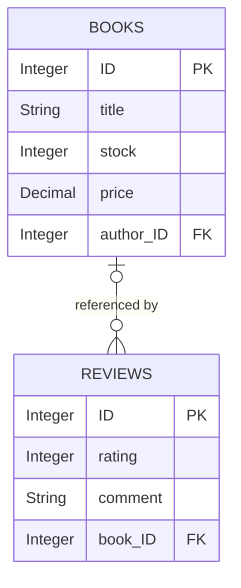

# CAP Bookshop Review Feature — Task Documentation

## 1. Project Overview

This project is a sample book-catalog service built with the SAP Cloud Application Programming Model (CAP). Its `CatalogService` exposes books and authors and implements a custom stock-order action. The review feature extends the model with book reviews, exposes them through the catalog service, validates ratings when reviews are created, and includes a Python client that posts three reviews and calculates averages for that run.

This document describes the implementation present in the repository. Runtime-dependent behavior is identified separately from behavior established by source inspection.

## 2. Requirements

| Requirement | Implementation status |
|---|---|
| Define reviews with a rating and comment | Implemented in `db/schema.cds` as `Reviews.rating : Integer` and `Reviews.comment : String(1000)`. |
| Associate each review with a book | Implemented as `Reviews.book : Association to Books`. CAP exposes the association's generated foreign-key field as `book_ID` in the OData payload used by the Python client. |
| Expose reviews in the catalog OData service | Implemented as a projection on `my.Reviews` in `srv/cat-service.cds`. |
| Validate ratings from 1 through 5 on the server | Implemented in a `before('CREATE', 'Reviews')` handler in `srv/cat-service.js`. The check requires an integer in the inclusive range 1–5. |
| Post three reviews and calculate averages by book | Implemented in `post_reviews.py`. It submits three reviews and calculates averages from those three successful POSTs in the current script run. It groups by the returned book title, not by database review history. |

The source has no review-specific CSV seed file or automated test file. Reviews are created by API requests, including the requests in the Python script.

## 3. Technology Stack

| Technology | Evidence in the repository |
|---|---|
| SAP Cloud Application Programming Model | `@sap/cds` dependency and CAP service implementation |
| CDS | Data model in `db/schema.cds`; service definition in `srv/cat-service.cds` |
| Node.js | `package.json` requires Node.js `>=20` |
| OData V4 | Catalog service is exposed at the OData V4 route documented by the project and used by `post_reviews.py` |
| SQLite | `@cap-js/sqlite` is listed as a development dependency; no explicit production database configuration is present in `package.json` |
| Python | `post_reviews.py` |
| Python `requests` | Imported by `post_reviews.py`; it is not listed in a Python dependency manifest |

## 4. Data Model

The namespace is `my.bookshop`. `Books` and `Reviews` use the CAP `managed` aspect. `Reviews` has an integer key, an integer rating, a bounded string comment, and a to-one association to `Books`.

```cds
entity Reviews : managed {
  key ID : Integer;
  rating : Integer;
  comment : String(1000);
  book : Association to Books;
}
```

The association is declared in CDS rather than as a handwritten `book_ID` field. CAP derives the foreign-key property used in the OData request from that association. The Python script confirms the payload property it uses is `book_ID`.

`managed` contributes standard audit fields (`createdAt`, `createdBy`, `modifiedAt`, and `modifiedBy`) to the entity model. The review schema does not declare explicit `not null`, minimum, or maximum constraints on `rating`; the 1–5 range is enforced by the JavaScript create handler.



The diagram shows the relationship implied by the review-to-book to-one association: a review can reference zero or one book, and a book may be referenced by multiple reviews. The source does not declare a separate reverse `Books.reviews` association.

## 5. Implementation and File Structure

| File path | Purpose | Main implementation details |
|---|---|---|
| `db/schema.cds` | Persistent domain model | Declares `Books`, `Authors`, and `Reviews`; `Reviews.book` associates reviews with books. |
| `srv/cat-service.cds` | OData service model | Projects `Books`, `Authors`, and `Reviews` into `CatalogService`; declares `submitOrder(book, quantity)`. |
| `srv/cat-service.js` | Catalog service behavior | Appends a discount label to titles when stock exceeds 100; decrements stock for orders when enough stock is available; validates review ratings before `CREATE`. |
| `post_reviews.py` | Review client and per-run calculation | Fetches books, posts three review payloads, checks HTTP errors with `raise_for_status()`, groups successful ratings by title, and prints averages. |
| `db/data/my.bookshop-Books.csv` | Sample book data | Contains book IDs 1 and 2, including their stock, price, and author IDs. |
| `db/data/my.bookshop-Authors.csv` | Sample author data | Contains author IDs 101 and 150 and their names. |
| `package.json` | Node.js project configuration | Declares CAP, Express, SQLite development dependencies, Node.js `>=20`, and the `npm start` script (`cds-serve`). |
| `package-lock.json` | npm dependency lock | Locks the resolved npm dependency graph (lockfile version 3). |
| `README.md` | Project usage documentation | Documents setup, catalog endpoints, sample review requests, and the Python script. |

The repository also contains VS Code launch, task, settings, and extension-recommendation files under `.vscode/`, plus `.gitignore` and `eslint.config.mjs`. No automated test files were found during inspection.

## 6. OData API

The service definition is `CatalogService`. The documented and script-configured OData V4 service root is:

```text
http://localhost:4004/odata/v4/catalog
```

The root and entity paths are derived from the CAP service definition and match the route used by `post_reviews.py`. Metadata and live endpoint responses were not fetched as part of this documentation task.

| Operation | Method and path | Source-supported behavior |
|---|---|---|
| Read service metadata | `GET /odata/v4/catalog/$metadata` | CAP OData metadata endpoint; live response not verified here. |
| List reviews | `GET /odata/v4/catalog/Reviews` | `Reviews` is exposed by the service; live response not verified here. |
| Create a review | `POST /odata/v4/catalog/Reviews` | CAP processes the entity create; the custom handler validates the rating before creation. |

The CDS association `book : Association to Books` is represented in the request body by CAP's generated `book_ID` foreign-key field. The same field is used in the Python script:

```powershell
$body = @{
    rating  = 5
    comment = "Excellent book!"
    book_ID = 1
} | ConvertTo-Json

Invoke-RestMethod `
    -Uri "http://localhost:4004/odata/v4/catalog/Reviews" `
    -Method Post `
    -ContentType "application/json" `
    -Body $body
```

This is an illustrative request, not a request executed during this documentation task. The source does not define a custom success response body or status code. CAP supplies the OData response; exact live response details have not been verified here.

## 7. Rating Validation

The custom handler in `srv/cat-service.js` is registered for `before('CREATE', 'Reviews')`. It reads the submitted value from `req.data.rating` and applies this condition:

```js
if (!Number.isInteger(rating) || rating < 1 || rating > 5) {
  req.error(400, 'Rating must be an integer between 1 and 5');
}
```

- **Accepted by the condition:** integer values 1, 2, 3, 4, and 5.
- **Rejected by the condition:** non-integers and integers below 1 or above 5.
- **Error signaled:** HTTP status 400 with message `Rating must be an integer between 1 and 5`.
- **Scope:** review creation (`CREATE`) only. This handler does not register validation for updates.

The repository defines the error status and message in code, but the serialized OData error response was not captured during this documentation task.

## 8. Python Testing Script

`post_reviews.py` is an executable client script, not an automated test suite. Its flow is:

1. Send `GET` to `/Books`, call `raise_for_status()`, and read the OData `value` array.
2. If no books are returned, print a diagnostic message and exit with status 1.
3. Select up to the first two books returned.
4. Prepare three reviews: ratings 5 and 4 for the first selected book, and rating 3 for the last selected book.
5. For each review, send `POST /Reviews` with `rating`, `comment`, and `book_ID`; call `raise_for_status()` and print the book title.
6. Store the successful ratings in an in-memory `defaultdict(list)` keyed by book title, then print each arithmetic mean to two decimal places.

HTTP errors are not caught or converted into custom output; `requests` raises when `raise_for_status()` encounters an unsuccessful response, and execution stops at that request. The script does not retrieve existing reviews or calculate averages from persisted review records. The exact data set used is the three reviews prepared during the current execution.

The book title used for grouping and display is the title returned by the Books endpoint. Since the service's `after('each', Books, ...)` handler appends ` -- 11% off!` for books with stock greater than 100, that label can also appear in the printed title.

## 9. Setup and Execution

Run these commands in PowerShell from the project root:

```powershell
Set-Location "C:\Users\lumaa\OneDrive\Desktop\projects\Bookshops\bookshop-final"
npm install
npm start
```

The `start` script runs `cds-serve`. Leave the CAP server running in that terminal. The project requires Node.js 20 or later.

In a second PowerShell terminal, check the service metadata and retrieve reviews:

```powershell
Invoke-WebRequest -Uri 'http://localhost:4004/odata/v4/catalog/$metadata'
Invoke-RestMethod -Uri "http://localhost:4004/odata/v4/catalog/Reviews" -Method Get
```

The endpoint paths follow the declared service and entity names. A running server's metadata and review response were not verified during preparation of this document.

Install the Python dependency in the intended Python environment and run the script:

```powershell
python -m pip install requests
python post_reviews.py
```

The script requires the CAP server to be running at `localhost:4004`. The repository does not include `requirements.txt` or another Python dependency manifest.

## 10. Testing and Verification

No automated test suite or test files were found. The table distinguishes the execution log supplied for the project from cases that have not been run as part of this documentation task.

| Scenario | Status | Evidence or expected behavior |
|---|---|---|
| Create a valid review | **Verified in supplied run log** | The supplied `post_reviews.py` output reports three reviews created. It does not include response bodies or explicit status codes. |
| Reject an invalid rating | **Not yet verified** | Source inspection shows `req.error(400, 'Rating must be an integer between 1 and 5')` for a non-integer or value outside 1–5 during `CREATE`. |
| Retrieve reviews | **Not yet verified** | `Reviews` is projected in `CatalogService`; no live `GET /Reviews` response was captured. |
| Submit three reviews | **Verified in supplied run log** | The supplied output contains three `Review created for:` lines. |
| Calculate average ratings per book | **Verified in supplied run log** | The supplied output shows averages calculated from the three review ratings. In code, grouping uses title as the key. |

“Verified in supplied run log” refers to the Python output supplied with the task and reflected in the existing README. It is not a claim that an automated test suite passed.

## 11. Sample Requests and Results

### Illustrative valid request

The following request uses book ID 1 from `db/data/my.bookshop-Books.csv` and the association foreign-key property used by the script:

```powershell
$body = @{
    rating  = 5
    comment = "Excellent book!"
    book_ID = 1
} | ConvertTo-Json

Invoke-RestMethod `
    -Uri "http://localhost:4004/odata/v4/catalog/Reviews" `
    -Method Post `
    -ContentType "application/json" `
    -Body $body
```

This request is illustrative; its response has not been captured here.

### Illustrative invalid request

Rating 6 is outside the range checked by the create handler:

```powershell
$body = @{
    rating  = 6
    comment = "Illustrative invalid rating"
    book_ID = 1
} | ConvertTo-Json

Invoke-RestMethod `
    -Uri "http://localhost:4004/odata/v4/catalog/Reviews" `
    -Method Post `
    -ContentType "application/json" `
    -Body $body
```

Expected from source inspection: the create handler signals status 400 with `Rating must be an integer between 1 and 5`. This error response has not been captured in a live request.

### Supplied Python execution output

The following is the output provided for a project run; it is not a generated or predicted result:

```text
Review created for: Wuthering Heights
Review created for: Wuthering Heights
Review created for: The Raven -- 11% off!

Average ratings:
Wuthering Heights: 4.50/5
The Raven -- 11% off!: 3.00/5
```

Titles and averages may differ when the returned books or ratings differ.

## 12. GitHub Repository and Changes

The project was pushed during the preceding project work to [rasmusmaria26-cell/Bookshop-CAP](https://github.com/rasmusmaria26-cell/Bookshop-CAP). The relevant published commits visible in that work are:

| Commit | Change |
|---|---|
| `c7be585` | Added the Bookshop CAP project files to the repository. |
| `82d830e` | Added the Python review output example to the README. |

The local checkout inspected for this document has `origin` configured as `https://github.com/Boopalan206/bookshop-final.git` and its local `main` at `881cfbe` (`CAP Bookshop example for intern training`). At inspection time, `README.md`, `db/schema.cds`, `package.json`, `srv/cat-service.cds`, and `srv/cat-service.js` had local modifications, and `post_reviews.py` was untracked relative to that checkout. The local checkout's configured `origin` therefore differs from the GitHub repository listed above. No commit or push was performed for this documentation task.

## 13. Conclusion

The implementation adds a managed `Reviews` entity associated with books, exposes it through `CatalogService`, validates rating values on review creation, and provides a Python script that creates three reviews and calculates per-title averages for that run. The source and the supplied Python output establish the implementation and a successful script run; invalid-rating handling and live OData metadata/read responses remain unverified by captured execution results. No application code or configuration was changed for this documentation task.
